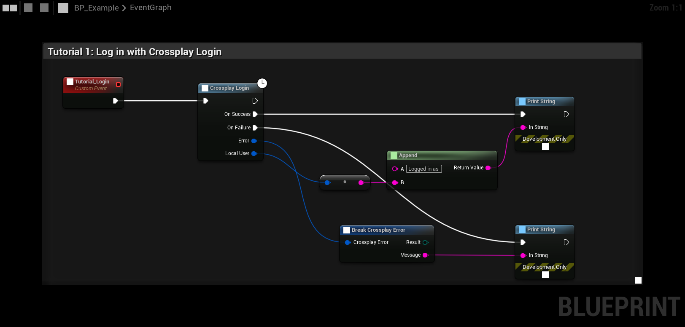

# Tutorial 1: Log in

Every other node needs a logged in player, so this is the first thing your game does. **Crossplay Login** logs in
to the platform (Steam) and then to the crossplay service (EOS) with the same account.

## The graph

1. **Tutorial_Login** is a custom event. Call it once, for example from **Event Init** in your GameInstance or from
   the main menu's **BeginPlay**.
2. **Crossplay Login** starts the login. Its top exec pin continues at once. **On Success** and **On Failure** fire
   when the login is done.
3. **On Success** gives the **Local User**, a **Crossplay User Id**. Plug it into a string pin and it converts by
   itself (**To String (Crossplay User Id)**).
4. **On Failure** gives a **Crossplay Error**. Break it and print the **Message**.

Calling **Crossplay Login** again while logged in returns at once with the same user, so it is safe to call it from
every menu that needs it.

## Things to try

- Use **Get Local Display Name** on the **Crossplay Subsystem** to greet the player by name.
- Use **Get Login Status**, or bind **On Login Status Changed**, to show a "Logging in..." state in your UI.
- Switch on the error's **Result** (for example **Not Logged In** or **Not Supported**) to show your own messages.

See [Login](../features/login) for Epic accounts, Device ID logins and the login settings.

**Next:** [Host a lobby](host-lobby)
