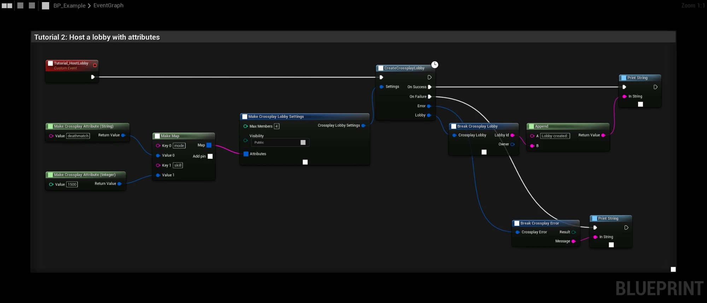

# Tutorial 2: Host a lobby

The host creates a lobby that other players can find and join. The lobby carries **attributes**, typed key/value
pairs that searches can filter on.

## The graph

1. **Make Crossplay Attribute (String)** and **Make Crossplay Attribute (Integer)** create two typed values: the game
   mode `"deathmatch"` and the skill `1500`.
2. **Make Map** puts them under the keys `mode` and `skill`.
3. **Make Crossplay Lobby Settings** describes the lobby:

   | Pin | Value | Description |
   |---|---|---|
   | Max Members | `4` | 1 to 64 players. |
   | Visibility | `Public` | Public lobbies are found by searches. |
   | Bucket | `default` | Searches only find lobbies in the same bucket. |
   | Attributes | The map | Searchable lobby attributes. |
   | Voice Chat | `true` | Members join the lobby's [voice chat](../features/voice-chat). |

4. **CreateCrossplayLobby** creates the lobby and makes the player its owner. **On Success** gives the new
   **Lobby**. Its **Lobby Id** is printed here.

The player must be logged in ([Tutorial 1](login)) and must not already be in a lobby. Otherwise **On Failure** fires
with **Not Logged In** or **Invalid Parameters**.

:::tip
The type of an attribute matters. A lobby that stores `skill` as an Integer is only found by an Integer filter on
`skill`. See [Attributes](../features/attributes).
:::

## Things to try

- Use the **Bucket** for things that must never mix, such as the build version or region.
- Change **Visibility** to **Invite Only** and invite players instead ([Invites](../features/invites)).
- Change attributes later with **SetCrossplayLobbyAttributes**, for example the current map.

**Next:** [Find and join a lobby](find-and-join)
