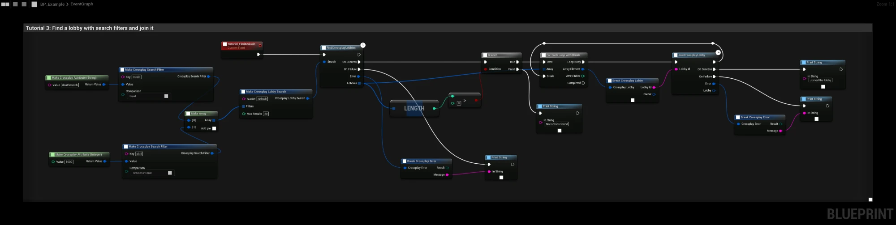

# Tutorial 3: Find and join a lobby

Other players search for the lobby from [Tutorial 2](host-lobby) with filters and join the first match. This is a
simple "quick match" button.

## The graph

1. Two **Make Crossplay Search Filter** nodes describe what to look for:

   | Key | Comparison | Value |
   |---|---|---|
   | `mode` | Equal | `"deathmatch"` (String) |
   | `skill` | Greater Or Equal | `1000` (Integer) |

2. **Make Array** collects the filters, and **Make Crossplay Lobby Search** adds the **Bucket** (`default`, the same
   as the host) and **Max Results** (`20`).
3. **FindCrossplayLobbies** runs the search. **On Success** gives the **Lobbies** that matched, best first.
4. **Length > 0** checks that something was found. If not, the graph prints "No lobbies found".
5. **For Each Loop with Break** goes through the results. **JoinCrossplayLobby** is called with the first lobby's
   **Lobby Id**, and its top exec pin goes to **Break**, so only one join is started.
6. **JoinCrossplayLobby** fires **On Success** with the joined lobby, or **On Failure**, for example with **Lobby
   Full** when someone else took the last place.

:::tip
Both players must use the same **Bucket**. If the search finds nothing, check that the bucket, the filter types and
the host's attributes match.
:::

## Things to try

- Show the results in a list instead of joining the first one. Each **Crossplay Lobby** has **Num Members**, **Max
  Members** and the **Attributes** to show in a row.
- When nothing is found, create a lobby instead ([Tutorial 2](host-lobby)). That is a complete matchmaking loop.
- **JoinCrossplayLobby** also takes Lobby Ids from invites and join requests ([Invites](../features/invites)).

**Next:** [React to lobby events](lobby-events)
