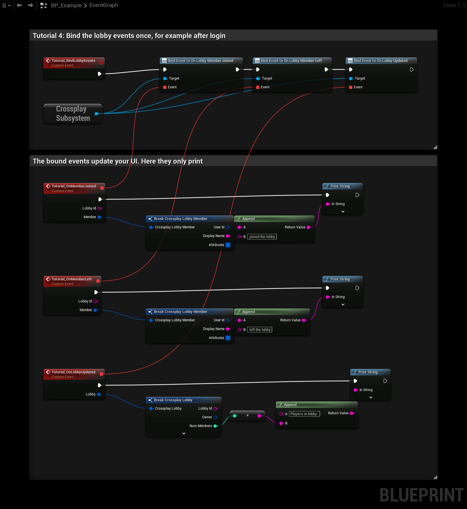

# Tutorial 4: React to lobby events

Lobbies change while the player is in them: members join and leave, and attributes change. The **Crossplay
Subsystem** has events for this. Bind them once and update your lobby UI from them.

## The graph

1. **Tutorial_BindLobbyEvents** gets the **Crossplay Subsystem** (a GameInstance subsystem, so it lives as long as
   the game) and binds three of its events:

   | Event | Bound to | When |
   |---|---|---|
   | **On Lobby Member Joined** | Tutorial_OnMemberJoined | A member joined. Gives the **Lobby Id** and the **Member**. |
   | **On Lobby Member Left** | Tutorial_OnMemberLeft | A member left or was kicked. |
   | **On Lobby Updated** | Tutorial_OnLobbyUpdated | Anything in the lobby changed. Gives the whole **Lobby**. |

2. The joined and left events break the **Crossplay Lobby Member** and print its **Display Name**.
3. The updated event prints the lobby's **Num Members**.

Call **Tutorial_BindLobbyEvents** once, for example after the login in [Tutorial 1](login) succeeded. Binding twice
gives every event twice.

:::caution
Bind the events from an object that lives as long as you need them, such as your GameInstance or a menu widget that
stays open. When the bound object is destroyed, for example by a map change, the binding is gone. Unbind with
**Unbind Event from On Lobby ...** when a widget closes.
:::

## Things to try

- Bind **On Lobby Left** to go back to the main menu when the player was kicked or the lobby closed.
- Use **On Lobby Updated** as the single place that rebuilds the member list: it fires for joins, leaves, owner
  changes and attribute changes.
- Bind **On Match Starting** to show a countdown before the match ([Matches](../features/match)).

All events are listed under [Lobbies](../features/lobbies#events).

**Next:** [Ready up and start the match](ready-and-start-match)
