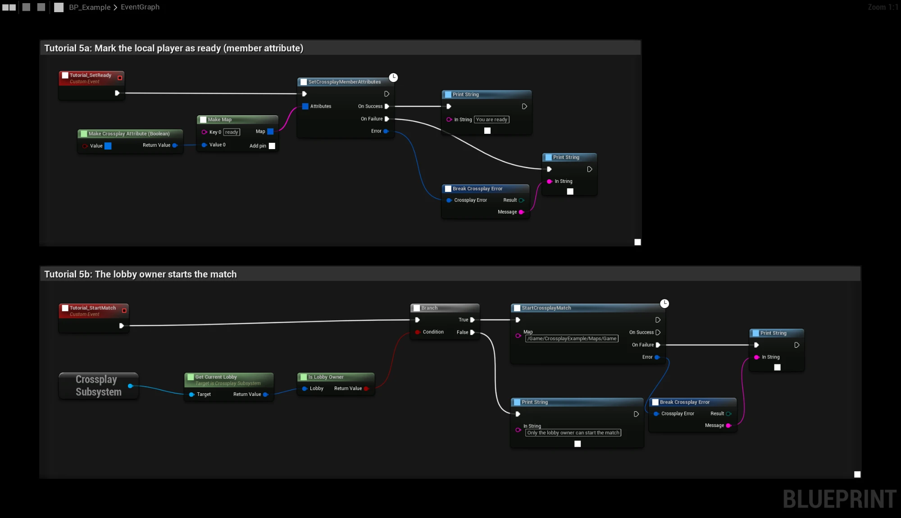
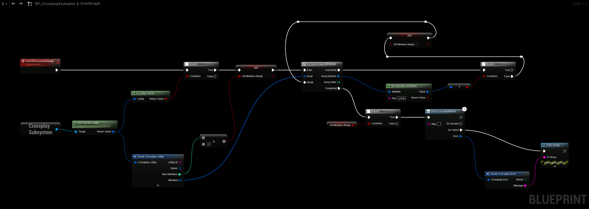

# Tutorial 5: Ready up and start the match

Members tell the others that they are ready with a **member attribute**. When everyone is ready, the lobby owner
starts the match: the owner opens the map as a listen server, and the other members travel to it by themselves.

## Mark the player as ready

1. **Make Crossplay Attribute (Boolean)** with `true`, in a **Make Map** under the key `ready`.
2. **SetCrossplayMemberAttributes** stores it on the local player's lobby member. Every member sees it in
   **On Lobby Updated** ([Tutorial 4](lobby-events)).

Read it back with **Get Member Attribute** (key `ready`) and **To Boolean (Crossplay Attribute)**, for example to show
a check mark next to each member.

## Start the match

1. **Get Current Lobby** on the **Crossplay Subsystem** gives the lobby the player is in.
2. **Is Lobby Owner** checks that the local player owns it. Only the owner can start the match. Other players get
   the message "Only the lobby owner can start the match".
3. **StartCrossplayMatch** opens `/Game/CrossplayExample/Maps/Game` as a listen server. An empty **Map** means the
   current map. The other members get **On Match Starting** and travel to the owner.

:::caution
The result of **StartCrossplayMatch** arrives after the map change. A Blueprint that is destroyed by the map change,
such as the menu's player controller or a level Blueprint, never gets **On Success**. Handle the result in your
GameInstance if you need it.
:::

## Check everyone is ready before starting

Call **StartIfEveryoneIsReady** when the host presses Start. After checking ownership, the graph sets **All Members Ready** from **Num Members > 0**. At the first member whose **ready** value is false, it clears the flag and breaks out of the loop. The **Completed** pin checks the flag before calling **StartCrossplayMatch**.

## Things to try

- Create a **Refresh Start Button** function. Read **Get Current Lobby**, initialize a Boolean to **Is Lobby Owner** AND **Members.Length > 0**, then loop over Members. If a member has no Boolean `ready` attribute or its value is false, set the Boolean to false and break. On Completed, pass the Boolean to **Set Is Enabled** on the start button.
- Run the check when the lobby screen opens and on **On Lobby Updated**, including after joins and leaves. Repeat it on click before calling **StartCrossplayMatch**. The node checks ownership, while your game defines readiness.
- Turn off **Auto Join Match** in the plugin settings and call **Join Match** from **On Match Starting** after a
  countdown ([Matches](../features/match#joining-yourself)).
- Clear `ready` again when the players return to the lobby after the match.

See [Matches](../features/match) for the requirements and how the P2P connection works.
