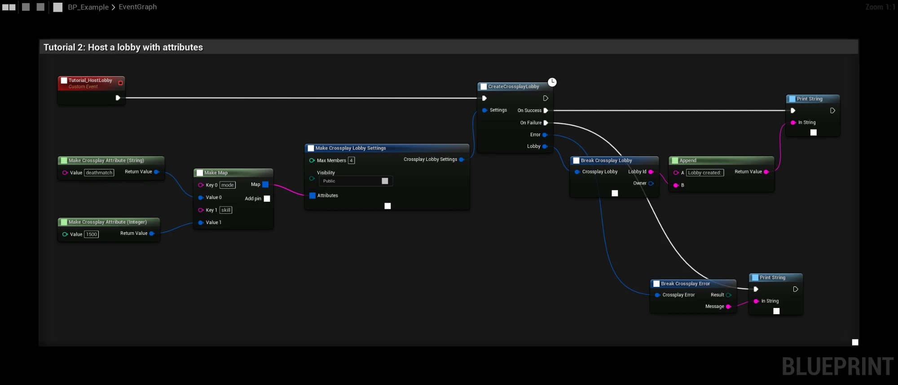
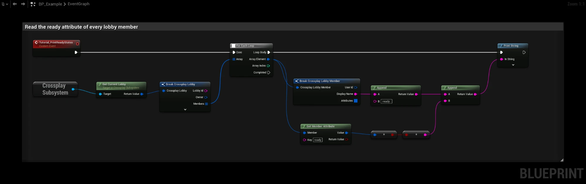

# Lobby and member attributes

Lobbies and members carry typed attributes (**Crossplay Attribute**):

| Type | Stored as |
|---|---|
| **String** | Text |
| **Int** | 64-bit integer |
| **Float** | Double |
| **Bool** | Boolean |

## Setting attributes

- In **CreateCrossplayLobby**, put them in the settings' **Attributes** map.
- **SetCrossplayLobbyAttributes** changes lobby attributes.
- **SetCrossplayMemberAttributes** changes the local player's member attributes, for example `ready` or `team`.

Plug a value into a **Crossplay Attribute** pin and it converts automatically, or use
**Make Crossplay Attribute (String / Integer / Integer64 / Float / Boolean)**. Integer and Integer64 are both stored
as 64-bit integers.



## Reading attributes

**Get Lobby Attribute** and **Get Member Attribute** return the attribute and whether it was found. Convert it with
**To String**, **To Integer**, **To Integer64**, **To Float** or **To Boolean** (Crossplay Attribute). **Equal
(Crossplay Attribute)** compares two attributes.

This graph prints the `ready` attribute of every member:



Other players see the change in **On Lobby Updated**.

## Search filters

A **Crossplay Search Filter** has a **Key**, a **Value** and a **Comparison**: **Equal**, **Not Equal**, **Greater**,
**Greater Or Equal**, **Less** or **Less Or Equal**.

Filters compare with the attribute's type, so **Greater** and **Less** work on numbers. A filter only matches an
attribute of the same type: a lobby that stores `skill` as an Integer is not found by a String filter on `skill`.

```text
FindCrossplayLobbies
  Bucket:  ranked
  Filters: mode  Equal          "deathmatch"   (String)
           skill GreaterOrEqual 1000           (Int)
           open  Equal          true           (Bool)
```

## Reserved keys

Keys starting with `cpc_` are reserved for the plugin, which uses them for each member's name, platform and ids and
for the match address. They are hidden from the attributes the plugin returns.

[Host migration](host-migration) uses keys starting with `hm_`.

## Steam lobbies

Steam stores only strings, so the plugin stores the types next to the values, and the types come back as they were
set. See [Steam lobbies](steam-lobbies) for how searches differ.
