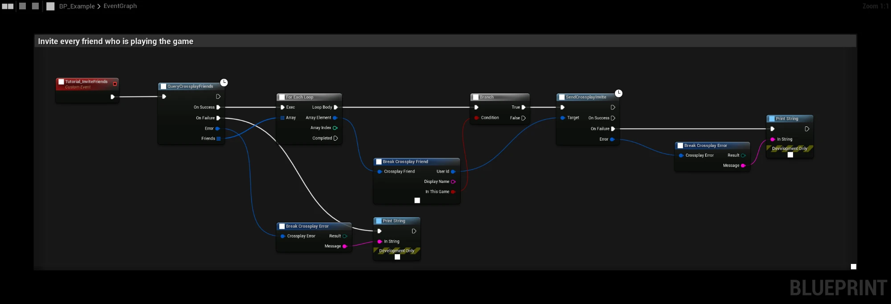
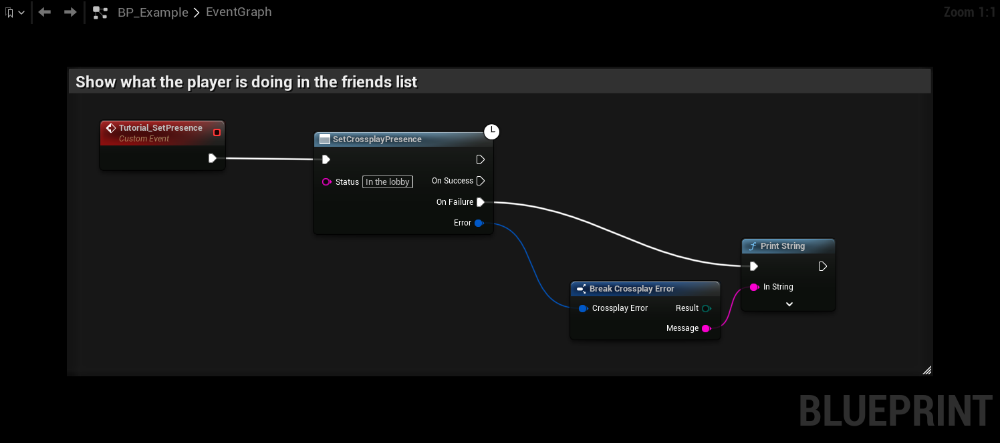

# Friends and presence

## QueryCrossplayFriends

**QueryCrossplayFriends** returns the player's friends. Each **Crossplay Friend** has:

| Field | Description |
|---|---|
| User Id | The friend's **Crossplay User Id**. **Product User Id** is filled in when the friend has logged in to the game with crossplay at least once. |
| Display Name | The friend's name. |
| Presence | **Offline**, **Online**, **Away** or **In Game**. |
| Presence Text | The text the friend set with **SetCrossplayPresence**. |
| Relationship | **Friend**, **Request Received** or **Request Sent**. See [Friend requests](#friend-requests). |
| In This Game | True when the friend is playing this game. |

Friends with a Product User Id can be passed straight to **SendCrossplayInvite**. Friends without one have never
played the game with crossplay; invite them with **Show Invite Overlay**. See [Invites](invites).

If looking up the Product User Ids fails, the friends list is still returned, without them.

This graph invites every friend who is playing the game:

### Steam or Epic friends

| Player logged in with | Friends |
|---|---|
| Steam | The Steam friends list. **In This Game** is set for friends playing the same Steam app. |
| Epic account (launcher, account portal or Dev Auth) | The Epic friends list, with name and presence from EOS. **In This Game** is set for friends playing the same EOS product. Used even when Steam is running. |
| Device ID | No friends list. The node fails with **Not Supported**. |

## SetCrossplayPresence

**SetCrossplayPresence** sets the player's status text, for example `In the lobby` or `Playing Deathmatch`.

- **Steam:** the `status` rich presence key. Steam only shares it between friends playing the same game, so the
  **Presence Text** of a Steam friend in another game is empty. A change fires **On Friend Updated**.
- **Epic account:** EOS presence with status Online and the text as rich text (at most 255 bytes).

## Friend requests

**QueryCrossplayFriendRequests** returns the friend requests the player has received and sent, as
**Crossplay Friend** with **Relationship** set to **Request Received** or **Request Sent**.

**On Friend Request Received** fires on the subsystem when a new request arrives. Steam only.

EOS only lists requests for products that have that permission in the Developer Portal.

## Social actions

**CrossplaySocialAction** does something with another player, on the platform the local player is logged in with:

| Action | Steam | Epic account |
|---|---|---|
| **Show Profile** | Opens the profile in the Steam overlay. | Not Supported |
| **Add Friend** | Opens the Steam overlay to send the request. | Sends a friend request. |
| **Remove Friend** | Opens the Steam overlay to remove the friend. | Not Supported |
| **Accept Friend Request** | Opens the Steam overlay to accept. | Accepts the request. |
| **Reject Friend Request** | Opens the Steam overlay to reject. | Rejects the request. |
| **Block** | Opens the profile, since Steam has no block dialog. | Opens the Epic block dialog. |

## Blocking

- **Is User Blocked** returns whether the player has blocked a user.
- **Get Blocked Users** lists the blocked users. On Steam this includes ignored users.

Only users on the same platform as the local player can be checked. [Chat messages](lobbies#lobby-chat) from blocked
players are not passed on.

## Avatars

**GetCrossplayAvatar** returns a user's avatar as a **Texture 2D** (64 × 64 pixels), for example for an **Image** in
a friend or member row. Steam only, and only when the local player is on Steam. The EOS SDK has no avatars.

## Recent players

**Get Recent Players** lists the players the local player has shared a lobby with since the game started, at most
100. Each **Crossplay Recent Player** has a **User Id**, **Display Name** and **Last Seen**. The list is not saved
between runs.

On Steam, the plugin also reports them to Steam, so they show up under **Recent Players** in the Steam friends list.

## ResolveCrossplayUsers

**ResolveCrossplayUsers** looks up the Product User Id for your own lists of players, for example recent players
or a clan list. Pass users made with **Make Platform User Id** (a Steam or Epic account id), and it returns them with
**Product User Id** filled in for those who have logged in to the game with crossplay. Requires crossplay to be
active.
