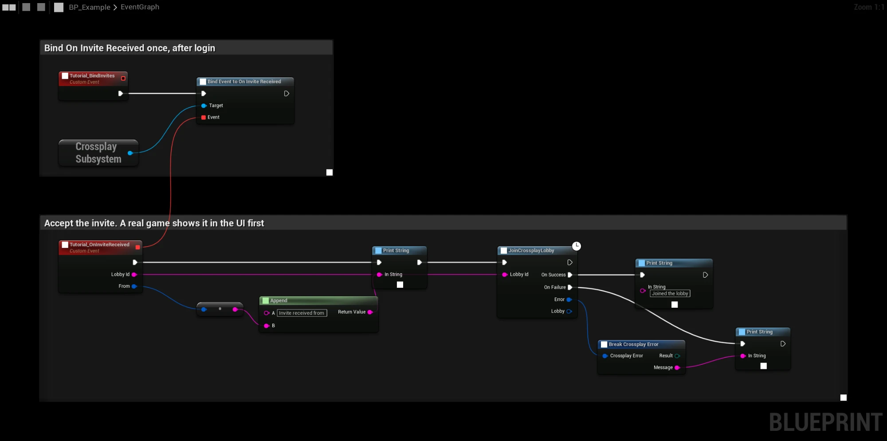
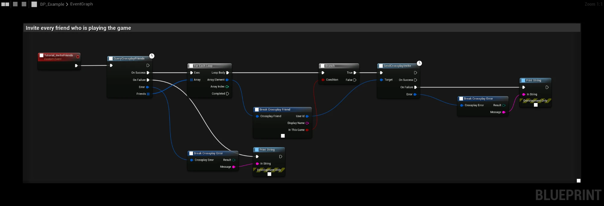

# Invites and join requests

There are two ways a player ends up in a friend's lobby:

- An **invite** arrives in the game. You show it in your UI, and the player accepts it with
  **JoinCrossplayLobby**.
- A **join request** means the player has already chosen to join from outside the game, in the Steam overlay or the
  EOS overlay. The plugin joins the lobby by itself.

## In-game invites (EOS)

**SendCrossplayInvite** with the friend's **Crossplay User Id** invites them to the current lobby. The friend gets
**On Invite Received** with the **Lobby Id** and the sender, shows it, and calls **JoinCrossplayLobby** to accept.
This works for Invite Only lobbies too.

- **Invites sent while the friend was offline** arrive right after their next login, but only if the lobby still
  exists. Old ones are rejected. The sender of such an invite is the lobby owner.
- Joining a lobby removes the invites to it.

### Pending invites

**Get Pending Invites** lists the invites the player has received but not joined or rejected. Each
**Crossplay Invite** has the **Lobby Id** and **From**, the sender. Use it to build an invite list in your UI, with
**GetCrossplayLobby** for details about each lobby.

**Reject Invite** with the **Lobby Id** removes an invite. For EOS invites it also rejects the invite in EOS. It
returns false when there is no such invite.

### Inviting by Steam or Epic account

**SendCrossplayInvite** also accepts a user with only a Steam or Epic account id, made with
**Make Platform User Id**. The plugin looks up the Product User Id first. A player who has never logged in to the game
with crossplay gives **Not Found**: use **Show Invite Overlay** for them instead.

**QueryCrossplayFriends** already fills in the Product User Id of every friend who plays, so the friends it returns
can be passed straight to **SendCrossplayInvite**. See [Friends and presence](friends-and-presence).

## Steam overlay invites

**Show Invite Overlay** opens the Steam invite dialog for the current lobby. It works for EOS lobbies too: the invite
carries a connect string (`+crossplay_lobby <id>`), so Steam friends who accept land in **On Join Requested** with the
EOS lobby. It returns false when the player is not in a lobby or Steam is not running.

For Steam lobbies, **SendCrossplayInvite** with a Steam user sends a Steam lobby invite, which arrives as
**On Invite Received**.

## Steam friends list

While the player is in a lobby, the plugin sets the Steam rich presence key `connect` (`+crossplay_lobby <id>` for
EOS lobbies, `+connect_lobby <id>` for Steam lobbies) and clears it when the lobby is left. This turns on
**Invite to Game** and **Join Game** in the Steam friends list and overlay, for the whole time in the lobby, matches
included. Your game does not have to call anything. Both arrive at the friend as a [join request](#join-requests).

The log shows `Steam join presence '+connect_lobby <id>': set` when it is set.

## Join requests

A join request comes from:

- **Join Game** or **Accept invite** in the Steam overlay or friends list,
- an invite accepted in the EOS overlay,
- the command line, when Steam starts the game from an invite (see below).

The plugin fires **On Join Requested** with the **Lobby Id** and whether it is a crossplay lobby, then leaves the
current lobby and joins the new one. If the join fails, for example because the lobby is gone, **On Join Request
Failed** fires with the reason.

Turn off **Project Settings → Plugins → Crossplay → Lobbies → Auto Accept Join Requests** to call
**JoinCrossplayLobby** yourself from **On Join Requested**.

## Starting the game from an invite

When a player accepts an invite while the game is not running, Steam starts the game with `+crossplay_lobby <id>`
(or `+connect_lobby <id>` for Steam lobbies). The plugin reads it at startup.

Join requests that arrive before login are kept, and **On Join Requested** fires right after **Crossplay Login**.
The game only has to log in as usual. A Steam lobby is joined even when the EOS login failed; an EOS lobby waits for a
successful login.

:::note
Steam starts the game that is installed for the App ID. Use your own Steam App ID and test with a build uploaded to
it. With Spacewar (480), accepting an invite while the game is not running starts Spacewar.
:::
