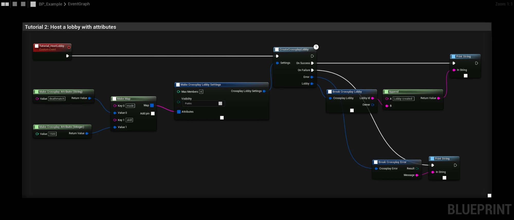
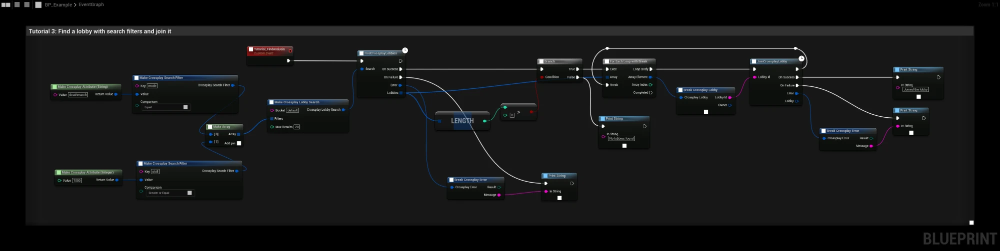
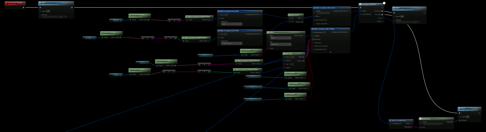
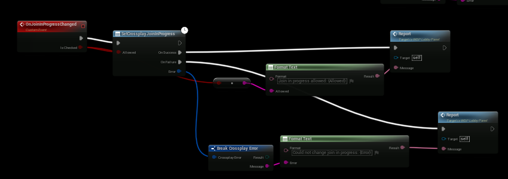
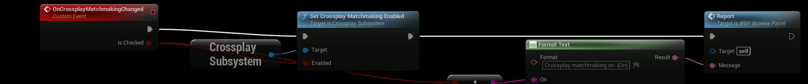
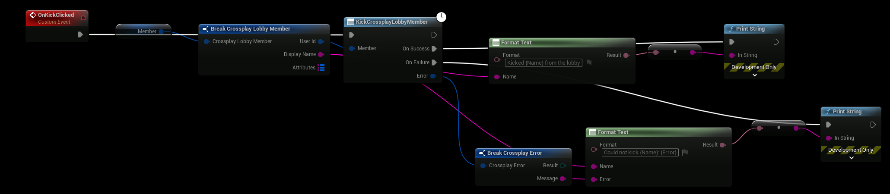
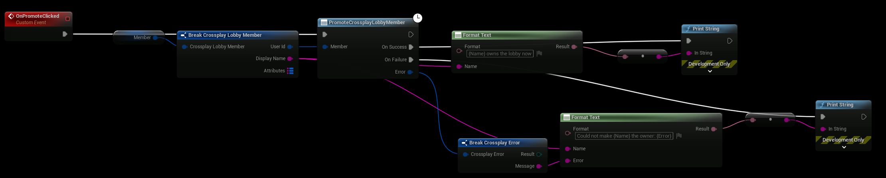
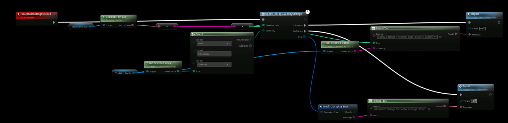
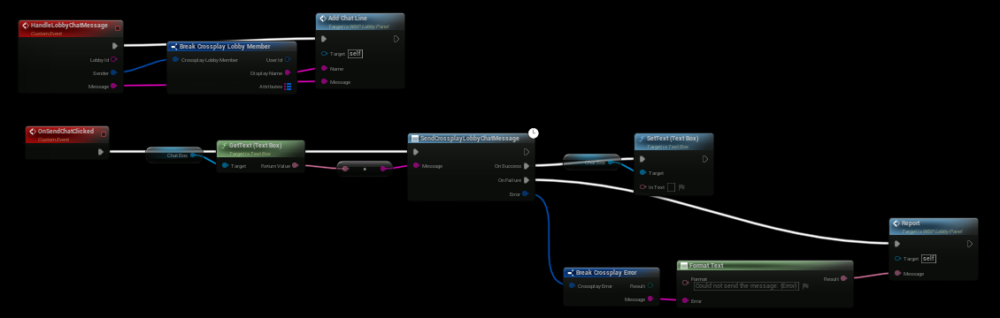
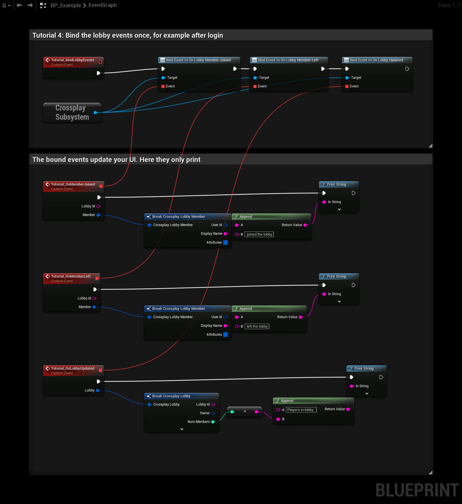

# Lobbies

When crossplay is active, lobbies are EOS lobbies that Steam players, Epic players and Device ID players all share.
Without EOS they are [Steam lobbies](steam-lobbies). The nodes are the same.

## Create

**CreateCrossplayLobby** creates a lobby and makes the player its owner.

| Setting | Default | Description |
|---|---|---|
| Max Members | `4` | 1 to 64. |
| Visibility | `Public` | See below. |
| Bucket | `default` | Searches only find lobbies in the same bucket. Use it for game mode, region or build version. |
| Attributes | Empty | Typed lobby attributes. See [Attributes](attributes). |
| Voice Chat | Off | Give the lobby a [voice room](voice-chat). |
| Allow Join In Progress | On | Let players join while the lobby's match is running. See [Join in progress](#join-in-progress). |
| Same Platform Only | Off | Only players on the owner's platform can find and join the lobby. See [Same platform only](#same-platform-only). |

| Visibility | EOS | Steam |
|---|---|---|
| **Public** | Found by searches | Public lobby |
| **Friends Only** | Joinable through presence, not found by searches | Friends only lobby |
| **Invite Only** | Only with an invite | Private lobby |

## Find

**FindCrossplayLobbies** searches with a **Crossplay Lobby Search**:

| Field | Default | Description |
|---|---|---|
| Bucket | `default` | The bucket to search in. |
| Filters | Empty | Typed filters, for example `skill >= 1000`. See [Search filters](attributes#search-filters). |
| Max Results | `20` | 1 to 200. |
| Include Unjoinable | Off | Also return lobbies the player can't join right now, for example a lobby list that greys them out. Use **Can Join Lobby** to check each one. |

## Join and leave

- **JoinCrossplayLobby** joins by **Lobby Id**, from a search result, an invite or a join request. It recognizes
  Steam lobby ids, so a Steam invite can be joined even when new lobbies are created in EOS.
- **LeaveCrossplayLobby** leaves the current lobby. When the owner leaves, EOS gives the lobby to another member.

A player is in one lobby at a time. **Create** and **Join** fail with **Invalid Parameters** ("Already in a lobby,
leave it first") while the player is in a lobby. A full lobby gives **Lobby Full**.

**Can Join Lobby** checks a search result before joining: it returns false when the lobby is full, locked by its
match, closed to the player's platform, or when the player has a [blocking sanction](moderation#sanctions).

## Quick match

**CrossplayQuickMatch** puts the player in a game with one node. It searches with the **Search**, and tries to join
the fullest lobby that has a free slot. If that join fails, it tries the next one, at most five. When no lobby can be
joined, it creates one with the **Create Settings**. On success, it returns the lobby the player is in.

Two players who quick match at the same time can each create their own lobby.

The example's Quick match button builds the search and the create settings from the same fields:

## Join in progress

A lobby with **Allow Join In Progress** off is locked while its [match](match) is running:

- **FindCrossplayLobbies** doesn't return it, unless **Include Unjoinable** is on.
- **JoinCrossplayLobby** fails with **Match In Progress**. This also applies to invited players, and to a player whose
  game crashed and who wants back in.

When the match [ends](match#ending-a-match), the lobby opens again.

The owner can change it at any time with **SetCrossplayJoinInProgress**, for example to close the lobby once the
round has started. Others get **Not Owner**.

The check is made by the joining player's game, so a Steam client without CrossplayCore doesn't follow it.

## Same platform only

**Same Platform Only** in the lobby settings limits an EOS lobby to the owner's platform. Players on other platforms
don't find it, and joining fails with **Platform Not Allowed**. Players logged in with the Dev Auth Tool count as
Epic players.

### Turning crossplay off

Players can turn crossplay off for themselves, for example with an option in the settings menu:

- **Set Crossplay Matchmaking Enabled** turns it on or off. The choice is saved in `GameUserSettings.ini`, so it is
  kept between runs.
- **Is Crossplay Matchmaking Enabled** returns the current choice. It is on by default.

With crossplay off, the player only finds and joins lobbies limited to their own platform, and the lobbies they
create are limited to their platform, as with **Same Platform Only**. [Steam lobbies](steam-lobbies) only have Steam
players anyway, so they are not affected.

## Read a lobby without joining

**GetCrossplayLobby** reads a lobby by **Lobby Id** without joining it, for example to show an invite with the lobby's
name, mode and number of players. It returns the lobby's settings and attributes. **Members** is only filled in for
the lobby the player is in.

## Manage the lobby

Only the lobby owner can call these. Others get **Not Owner**.

| Node | Description |
|---|---|
| **KickCrossplayLobbyMember** | Removes a member from the lobby. The owner can't kick themselves; leave the lobby instead. |
| **PromoteCrossplayLobbyMember** | Makes another member the owner. |
| **UpdateCrossplayLobbySettings** | Changes **Max Members** and **Visibility**. Max Members can't be lower than the number of members. Bucket and Voice Chat can't be changed after the lobby is created. |

The example's member row kicks the member it shows:

**PromoteCrossplayLobbyMember** works the same way:

The lobby settings panel reads Max Members from a text box and Visibility from a combo box:

### Kicked players

The kicked player gets **On Kicked From Lobby** and then **On Lobby Left**. The others get **On Lobby Member Left**.

A kicked player can't join the lobby again until the owner sends them a new invite with **SendCrossplayInvite**.

- **EOS lobbies** remove the member on the EOS side.
- **Steam lobbies** have no kick. The owner writes the kicked player in the lobby data, and the kicked player's game
  leaves by itself. A Steam client without CrossplayCore doesn't do this.

## Lobby chat

**SendCrossplayLobbyChatMessage** sends a text message to everyone in the lobby. The members get
**On Lobby Chat Message** with the **Lobby Id**, the sender as a **Crossplay Lobby Member**, and the message.
Messages are at most 256 characters; longer ones are cut. Messages from [blocked players](friends-and-presence#blocking)
are not passed on.

- **Steam lobbies** use Steam's lobby chat.
- **EOS lobbies** have no chat in EOS, so the message is sent as a member attribute. That is enough for lobby chat,
  but not for fast chat: EOS limits how often a lobby can be updated.

## The current lobby

| Node | Description |
|---|---|
| **Get Current Lobby** | The lobby the player is in, with its members and attributes. |
| **Is In Lobby** | Whether the player is in a lobby. |
| **Is Lobby Owner** | Whether the local player owns the lobby. |
| **Get Lobby Attribute** / **Get Member Attribute** | Read one attribute. |

A **Crossplay Lobby** has a **Lobby Id**, **Owner**, **Max Members**, **Num Members**, **Visibility**, **Crossplay**
(true for EOS lobbies), **Attributes**, **Members** and **Match Address** (set once a [match](match) has started).
Each member has a **User Id**, **Display Name** and **Attributes**.

**Required Platform** is set on a lobby that is limited to one platform, by **Same Platform Only** or when the owner has
[crossplay turned off](#turning-crossplay-off). It holds that platform, and is Unknown otherwise.

## Events

Bind these on the **Crossplay Subsystem**:

| Event | When |
|---|---|
| **On Lobby Updated** | The lobby changed: attributes, members, owner or match address. Gives the whole lobby. |
| **On Lobby Member Joined** | A member joined. Fires once the member's display name has arrived, at most 5 seconds after the join. |
| **On Lobby Member Left** | A member left or was kicked. |
| **On Lobby Left** | The player is no longer in the lobby: they left, were kicked or the lobby was closed. |
| **On Kicked From Lobby** | The owner kicked the player. **On Lobby Left** follows. |
| **On Lobby Chat Message** | A member sent a [chat message](#lobby-chat). |

A member who leaves before **On Lobby Member Joined** fired gives neither event.

