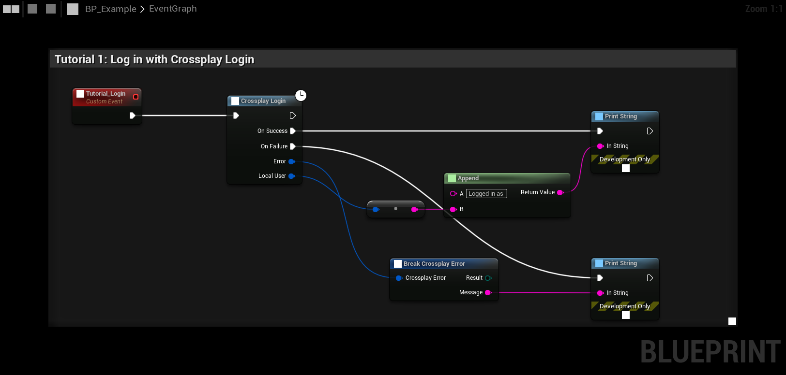

# Login

**Crossplay Login** logs the player in and returns their **Crossplay User Id**. The player only has to be logged in
once per game session. Calling it while a login is running waits for that login, and calling it when logged in
returns at once.

## Which login is used

The plugin picks the first login that applies:

| # | Login | When |
|---|---|---|
| 1 | **Dev Auth Tool** | `-CrossplayDevAuth=<name>` on the command line and **Use Dev Auth Tool** on. Not in Shipping. |
| 2 | **Epic account (launcher)** | The Epic Games Launcher started the game, and **Epic Account Login** is not **Never**. |
| 3 | **Epic account (saved login, portal)** | **Epic Account Login** is **Always**, Steam is not running and Dev Auth is off. |
| 4 | **Steam** | Steam is running. Steam session ticket → EOS Connect. |
| 5 | **Dev Auth Tool** | **Use Dev Auth Tool** on. The credential comes from the PIE instance. Not in Shipping. |
| 6 | **Device ID** | **Allow Device Id Login** on. Anonymous EOS login for this computer. |
| 7 | **Steam only** | Steam is running but EOS is not available. The player has no Product User Id, and lobbies are Steam lobbies. |

If none applies, the login fails with **Not Supported**.

## When the EOS login fails

When Steam is running but the EOS login fails, for example because the Steam App ID is not set up in the Steam
identity provider, **Crossplay Login** returns the error and the status is **Logged Out**. The player keeps their
Steam user (**Get Local User** has their Steam id), and what only needs Steam keeps working:

- [Steam lobbies](steam-lobbies), Steam invites and join requests,
- matches over Steam P2P, with the Steam id as the player id,
- [voice in the match](voice-chat#matches-engine-voip) and [host migration](host-migration).

Crossplay lobbies, EOS lobby voice, Epic friends and players from other platforms need a working EOS login. Calling
**Crossplay Login** again tries EOS again.

**On Login Status Changed** fires on the subsystem when the status changes between **Logged Out**, **Logging In**
and **Logged In**. Read the current status with **Get Login Status**, the player with **Get Local User** and their
name with **Get Local Display Name**.

## Steam

The Steam backend asks Steam for a Web API ticket and logs in to EOS Connect with it. The first time a Steam account
logs in, a Product User is created for it. The display name is the Steam persona name. See
[Steam setup](../getting_started/steam-setup).

## Epic accounts

**Project Settings → Plugins → Crossplay → Login → Epic Account Login** decides when players log in with their Epic
account (EOS Auth, then EOS Connect with the Epic ID token):

| Value | Description |
|---|---|
| **Never** | Epic accounts are not used. |
| **Launcher Only** (default) | When the Epic Games Launcher starts the game. The launcher passes `-AUTH_TYPE=exchangecode -AUTH_PASSWORD=<code>`, and that login wins over Steam. |
| **Always** | Also without the launcher, when Steam is not running. The plugin first tries the login saved from the last session, then opens the Epic account portal so the player can sign in. |

The player's display name comes from their Epic account. A saved login that Epic no longer accepts is removed, but not
when the login failed because there was no network.

A player logged in with an Epic account gets their **Epic** friends and presence, even when Steam is running. See
[Friends and presence](friends-and-presence).

The Developer Portal needs **Epic Games** as an identity provider for EOS Connect, and the client policy must allow
the scopes **Basic Profile**, **Friends List** and **Presence**. See [EOS setup](../getting_started/eos-setup).

### Scopes

A game that does not use Epic friends or Epic presence can turn off **Request Friends Scope** or
**Request Presence Scope** under **Project Settings → Plugins → Crossplay - Epic Online Services → Epic Account**. The
login then only asks for the scopes that are left on, and the client policy only needs those.

- With Friends off, **QueryCrossplayFriends** returns **Not Supported** for Epic accounts.
- With Presence off, **SetCrossplayPresence** returns **Not Supported**, friends come without presence, and lobbies
  are not tied to the Epic presence.

If the Epic login page says the client is not allowed a scope (for example `friends_list`), either allow it in the
client policy or turn the scope off here.

## Device ID

Without Steam, **Allow Device Id Login** (on by default) logs in to EOS anonymously. The display name is
**Device Id Display Name**, or the computer's name when that is empty.

A device id belongs to the computer, so every game on one computer gets the same Product User Id. Use the
[Dev Auth Tool](../getting_started/testing#the-dev-auth-tool) to test several players on one computer.

## Staying logged in

EOS Connect logins expire. The plugin renews the login by itself before it does, from Steam or from the Epic session.
If EOS logs the player out, the status goes to **Logged Out** and **On Login Status Changed** fires.

Call **Logout** from C++ (`UCrossplaySubsystem::Logout`) to log out yourself.
