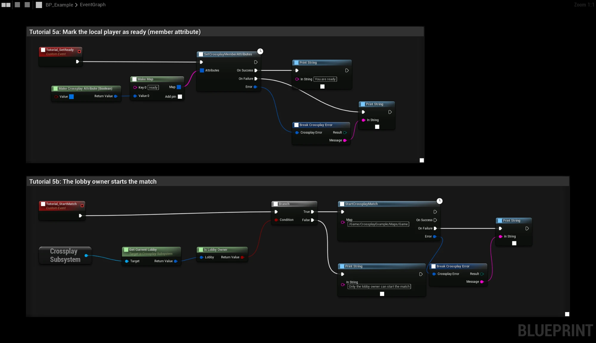
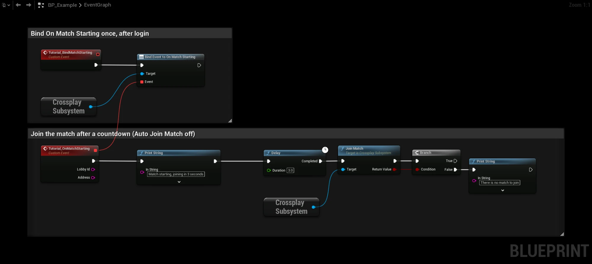

# Starting a match

A lobby is where players meet. **StartCrossplayMatch** takes them from the lobby into a networked game: the owner
hosts a listen server over P2P, and the other members travel to it.

## StartCrossplayMatch

1. The lobby owner calls **StartCrossplayMatch** with a map. An empty map means the current map. The map opens as a
   listen server on EOS P2P, and the owner's address is written to the lobby (**Match Address**).
2. The other members get **On Match Starting** with the **Lobby Id** and the address, and travel to the owner by
   themselves. Members who are already in a networked game (playing or hosting) are left where they are and get no
   event.

Only the owner can start the match. Others get **Invalid Parameters**.

See [Tutorial 5](../blueprint_tutorials/ready-and-start-match) for the graph step by step.

:::caution
The result of **StartCrossplayMatch** arrives after the map change. Handle it in the GameInstance, or bind to the
subsystem's events, not in a level Blueprint that is gone after the map change.
:::

## Joining yourself

Turn off **Project Settings → Plugins → Crossplay → Match → Auto Join Match** to decide when members travel. Then
call **Join Match** on the subsystem from **On Match Starting**, for example after a countdown. It returns false when
the lobby has no match.

Players who join the lobby after the match has started travel to it as well (or get **On Match Starting** when Auto
Join Match is off).

## No ports, no config

The plugin uses the engine's **SocketSubsystemEOS** and switches the game net driver to `NetDriverEOS` when the match
starts, so no `DefaultEngine.ini` changes are needed. Connections go through EOS relays when a direct connection is
not possible, so no ports have to be opened.

The project's own net driver comes back when the player is in a standalone map again with no match running in the
lobby, for example after leaving the lobby and returning to the menu, so later LAN or IP games work as before. While
the lobby's match is running, the P2P driver stays, so a client that loses the host can become the new host on the
same network ([host migration](host-migration)).

## Requirements

- Windows or Mac. See [Linux](#linux).
- An EOS platform from CrossplayCore, [EOSCore](../getting_started/eos-setup#with-eoscore-recommended) or
  OnlineSubsystemEOS. See [Where the EOS platform comes from](../getting_started/eos-setup#where-the-eos-platform-comes-from).
- In [Steam lobbies](steam-lobbies#matches-over-steam-p2p) the match runs over Steam P2P instead.

When P2P is not available for the lobby, **StartCrossplayMatch** fails with **Not Supported**.

## Linux

The engine has no EOS P2P socket subsystem (`SocketSubsystemEOS`) for Linux, so matches over EOS P2P don't work
there. On Linux, **StartCrossplayMatch** in an EOS lobby fails with **Not Supported**, and a Linux player can't
join a match over EOS P2P that a Windows or Mac player hosts.

Login, EOS lobbies, friends, presence, invites and voice chat work on Linux. For matches on Linux, use
[Steam lobbies](steam-lobbies#matches-over-steam-p2p), where the match runs over Steam P2P.
