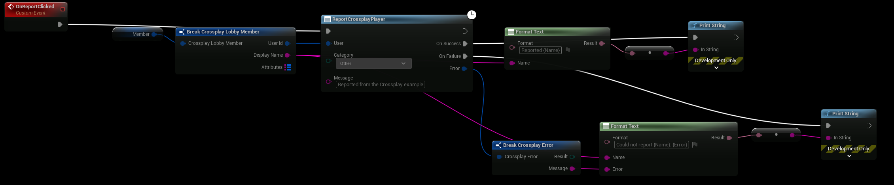

# Moderation

Reports and sanctions go through Epic Online Services, so they cover players on every platform. Both need a
crossplay login, and the client policy in the Epic Developer Portal must allow **Reports** and **Sanctions**.

## Reporting players

**ReportCrossplayPlayer** sends a player behavior report to Epic Online Services, for players on every platform. You
read the reports in the Epic Developer Portal.

| Input | Description |
|---|---|
| User | The player to report, for example a lobby member or a recent player. |
| Category | **Cheating**, **Exploiting**, **Offensive Profile**, **Verbal Abuse**, **Scamming**, **Spamming** or **Other**. |
| Message | Optional text for the report. Cut to 512 bytes. |

- Needs a crossplay login. Without one the node fails with **Not Logged In**.
- A user without a Product User Id, for example a Steam friend, is looked up first. A player who has never logged in
  to the game with crossplay gives **Not Found**.
- The player can't report themselves (**Invalid Parameters**).
- The client policy in the Developer Portal must allow **Reports**.

The example's member row has a Report button:

## Sanctions

Sanctions are placed on players in the Epic Developer Portal or by your backend, for example a ban from matchmaking
after reports.

### The local player

With **Query Sanctions On Login** on (the default), the plugin fetches the player's active sanctions right after
**Crossplay Login**:

- **Get Local Sanctions** returns them.
- **On Sanctions Updated** fires on the subsystem when they have arrived.

List the sanction actions that should keep a player out of lobbies in **Lobby Blocking Sanctions**, under
**Project Settings → Plugins → Crossplay → Moderation**, for example `RESTRICT_MATCHMAKING`. A player with an active
sanction in that list can't create, join or quick match: the nodes fail with **Sanctioned**, and the message says
until when. The sanctions are fetched after login, so a player can create a lobby before the answer arrives.

### Other players

**QueryCrossplaySanctions** returns the active sanctions of any player, for example to warn about a lobby member.
Leave **User** empty for the local player. A user without a Product User Id is looked up first.

Each **Crossplay Sanction** has:

| Field | Description |
|---|---|
| Action | The sanction's action, as set in the Developer Portal. |
| Reference Id | The id of the sanction. |
| Time Placed | When the sanction was placed. |
| Time Expires | When it ends. |
| Permanent | True when it never ends. |
