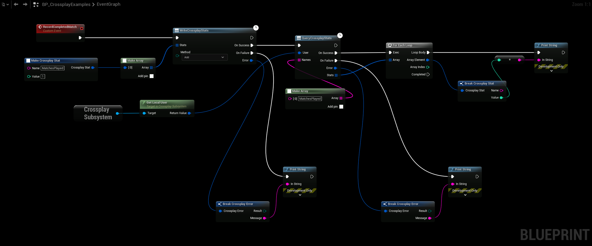
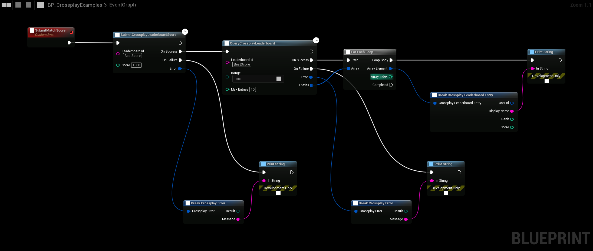
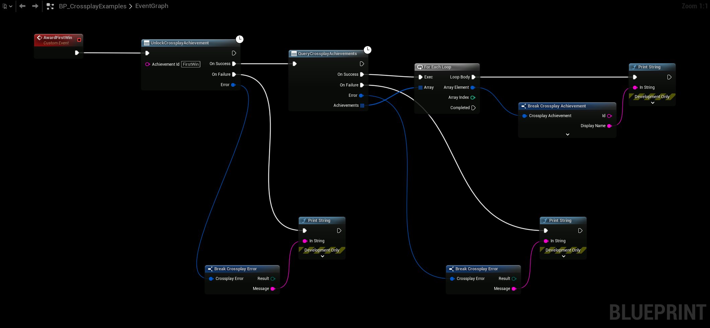

# Stats, achievements and leaderboards

Start these graphs after login. Configure the stat, achievement and leaderboard IDs on each backend your game uses. The IDs below are examples.

## Count completed matches

1. On match completion, make a **Crossplay Stat** with Name `MatchesPlayed` and Value `1`. Connect it through **Make Array** to **WriteCrossplayStats** and choose **Add**.
2. From **On Success**, call **QueryCrossplayStats** with **Get Local User** from the **Crossplay Subsystem** connected to User and Names containing `MatchesPlayed`. Find that name in the returned array and display its Value.
3. On Steam, define an integer stat. On EOS, configure SUM aggregation for this counter. EOS uses the aggregation configured in the Developer Portal for every write.
4. With **Stats Service** set to **Both**, one backend can succeed while the node returns failure for the other. Retrying Add can count the same match twice. Show the write error and avoid automatically resending the increment.

## Show a leaderboard

Configure a leaderboard for the best match score. On EOS, link it to a score stat with the intended aggregation. Call **SubmitCrossplayLeaderboardScore** with the leaderboard ID and the match score. Submitting on EOS writes to the linked stat, so sending the same score separately to that stat can count it twice for a sum.

From **On Success**, call **QueryCrossplayLeaderboard** with the same ID, Range **Top**, and Max Entries **10**. For each entry, add a widget row with Rank, Display Name and Score. Show an empty state for zero entries and the error message on failure. Use **Friends** for a friends tab. Test with two accounts with different scores so row order and identity are visible.

The graph prints each player's display name. To build a scoreboard row, also connect **Rank** and **Score** from **Break Crossplay Leaderboard Entry** to your widget. Both failure paths print the error message.

## Display an achievement

Call **QueryCrossplayAchievements** and create a row for each visible achievement using its display name and unlocked state. To award an achievement directly, pass its configured ID to **UnlockCrossplayAchievement**, then refresh the list on success.

For a halfway milestone on Steam, **SetCrossplayAchievementProgress** with Progress **50** displays progress. Reading the list back returns 0 for locked achievements and 100 for unlocked ones. On EOS, partial progress comes from writing the stat linked to the achievement. Setting progress directly below 100 returns **Not Supported**. At 100 the node requests an unlock on either backend.
## Show a halfway milestone on Steam

Define an achievement with the ID `TenWins` in your Steam app. When your game's win counter reaches five, call a custom event named **ShowSteamHalfwayMilestone** once.

1. Connect the event to **SetCrossplayAchievementProgress** with **Achievement Id** set to `TenWins` and **Progress** set to `50`.
2. From **On Success**, print “Steam accepted the halfway milestone”. Keep the win count in your game's stats. A later **QueryCrossplayAchievements** returns 0 for this achievement while it is locked.
3. From **On Failure**, connect **Error** to **Break Crossplay Error** and print **Message**.
4. At ten wins, call **UnlockCrossplayAchievement** with the same ID. For EOS, link the achievement to a wins stat in the Developer Portal and use **WriteCrossplayStats** as wins are earned.