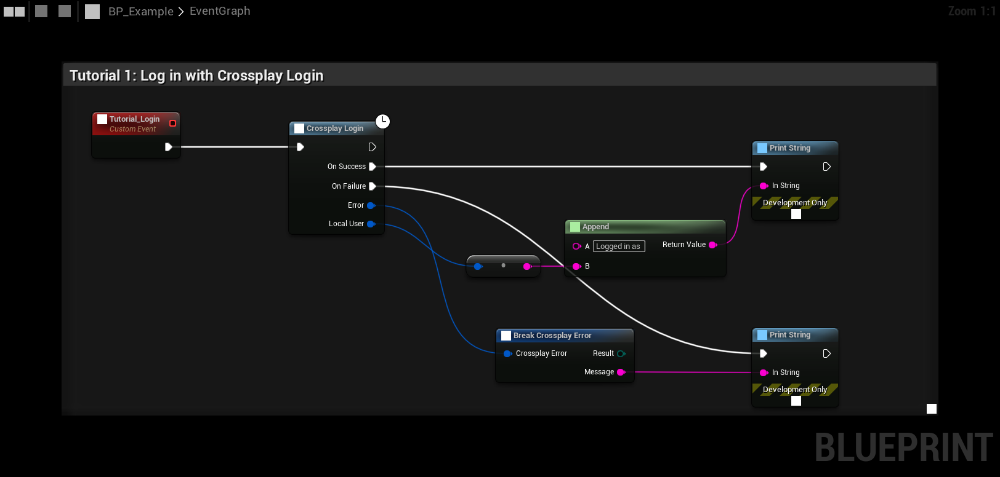
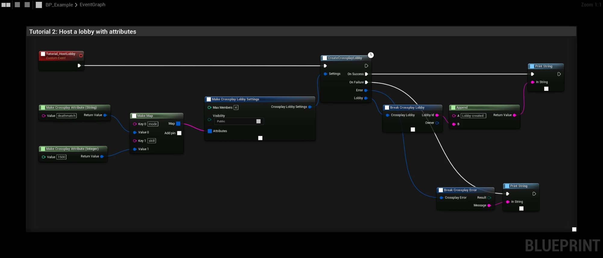
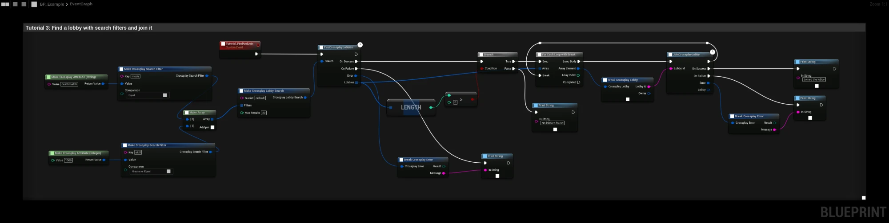
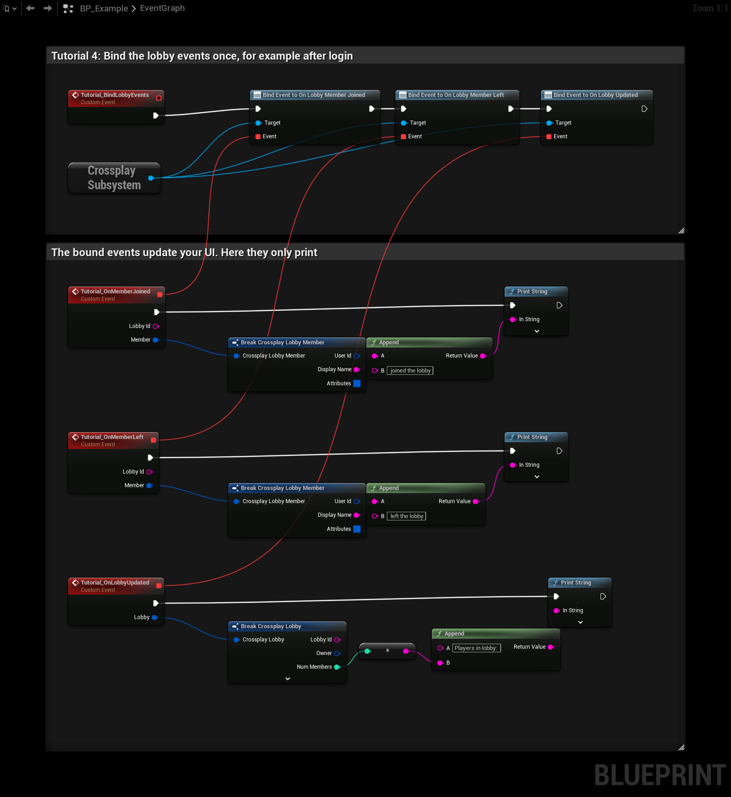
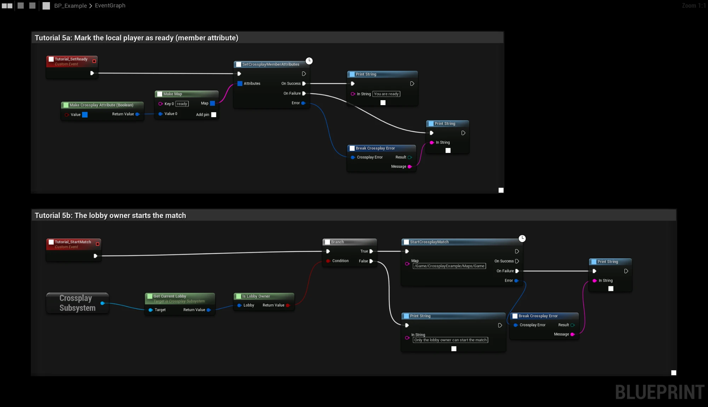
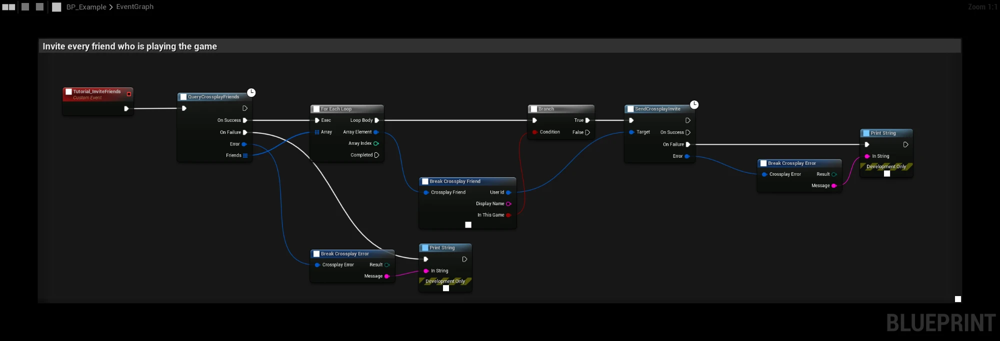

# Quick Start

:::tip Example project
See every step below in a working game in the [example project](../../example-project), or try the playable build
first.
:::

All nodes are in the **Crossplay** category. The latent nodes have an **On Success** and an **On Failure** pin, and
return a **Crossplay Error** with a **Result** and a **Message**.

## 1. Log in

Call **Crossplay Login** once, for example from your GameInstance or main menu. It logs in to Steam and then to EOS
with the Steam account, and returns the local player's **Crossplay User Id**.

Calling it again while logged in returns at once with the same user. See [Login](../features/login) for the other
ways players can log in.

## 2. Create a lobby

The host calls **CreateCrossplayLobby** with a **Crossplay Lobby Settings**:

| Field | Example |
|---|---|
| Max Members | `4` |
| Visibility | `Public` |
| Bucket | `default` |
| Attributes | `mode` = `"deathmatch"`, `skill` = `1500` |

[Tutorial 2](../blueprint_tutorials/host-lobby) explains the graph step by step.

## 3. Find and join it

Other players call **FindCrossplayLobbies** with the same **Bucket**, optionally with filters, and
**JoinCrossplayLobby** with the **Lobby Id** of a result.

Bind **On Lobby Member Joined**, **On Lobby Member Left** and **On Lobby Updated** on the **Crossplay Subsystem** to
keep your lobby UI up to date:

See [Tutorial 3](../blueprint_tutorials/find-and-join) and [Tutorial 4](../blueprint_tutorials/lobby-events).

## 4. Start the match

When everyone is ready, the lobby owner calls **StartCrossplayMatch** with a map. The map opens as a listen server
over EOS P2P, and the other members travel to it by themselves. See [Matches](../features/match).

## 5. Invite friends

- **QueryCrossplayFriends** gives the friends list. Friends with a Product User Id can be invited with
  **SendCrossplayInvite**.
- **Show Invite Overlay** opens the Steam invite dialog for the current lobby.

This graph invites every friend who is playing the game:

See [Invites and join requests](../features/invites).

## Next step

Read [How it works](how-it-works), then [test with several players](testing).
