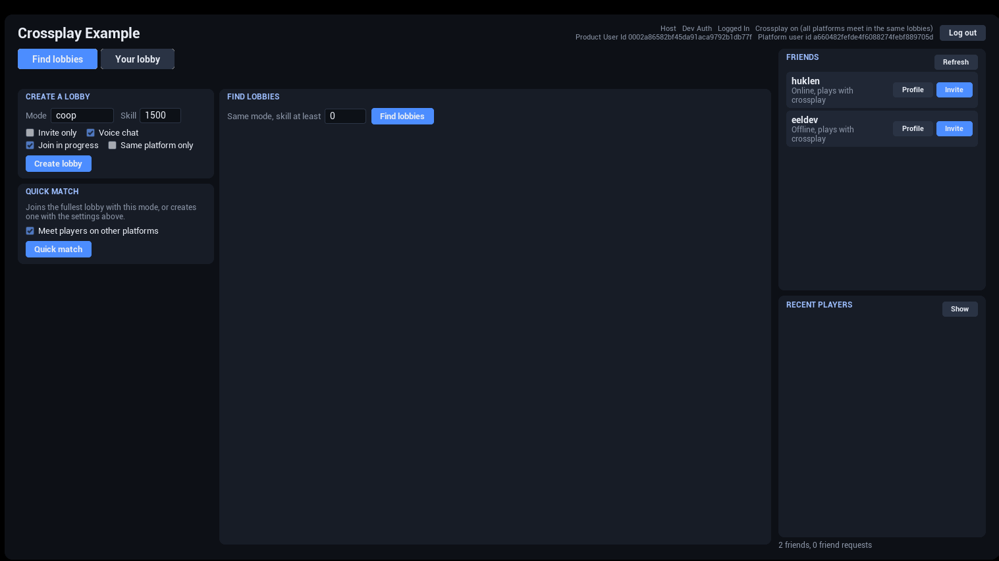
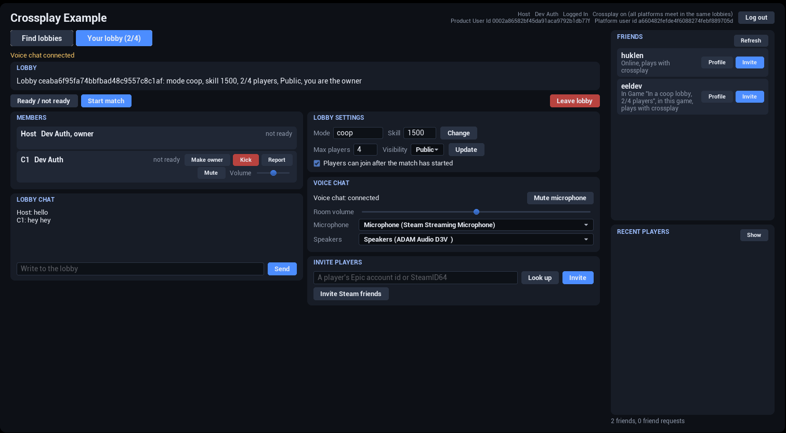

# Example Project

The example project shows CrossplayCore in Blueprint: login, crossplay lobbies, search filters, ready checks,
invites, friends, voice chat, matches over EOS P2P and host migration.

The graphs on the feature pages come from this project.

## Playable build
Try the example without opening the editor. Download the packaged Windows build (about 320 MB), unzip it and run
`CrossplayExample.exe`:
- [Download Playable Example (Windows)](https://eeldev.com/tmp/CrossplayExample_Packaged_1.0.zip)

## Blueprint Example Project
You can download the project from GitHub:
- [CrossplayExample on GitHub](https://github.com/eeldev-ue4/CrossplayExample)

The project is made with **Unreal Engine 5.8** and only needs **CrossplayCore**. Steam runs on the engine's
**OnlineSubsystemSteam** and **SteamSockets**, and the EOS platform is created by CrossplayCore.

To use it for your own game, put your own EOS keys in **Project Settings → Plugins → Crossplay - Epic Online
Services** (see [EOS setup](docfiles/getting_started/eos-setup#without-eoscore)), and your own Steam App ID in
`Config/DefaultEngine.ini`. The project uses Spacewar (480), which EOS does not accept for Steam logins, see
[Steam as an EOS identity provider](docfiles/getting_started/steam-setup#steam-as-an-eos-identity-provider).
